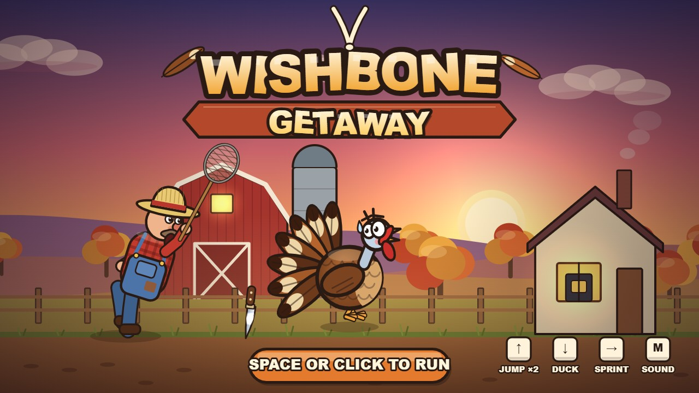
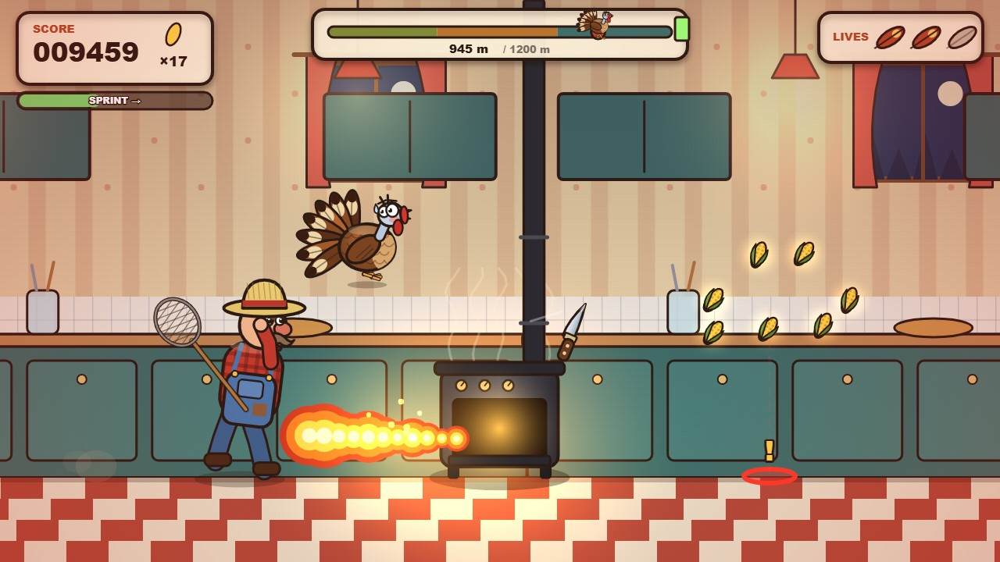
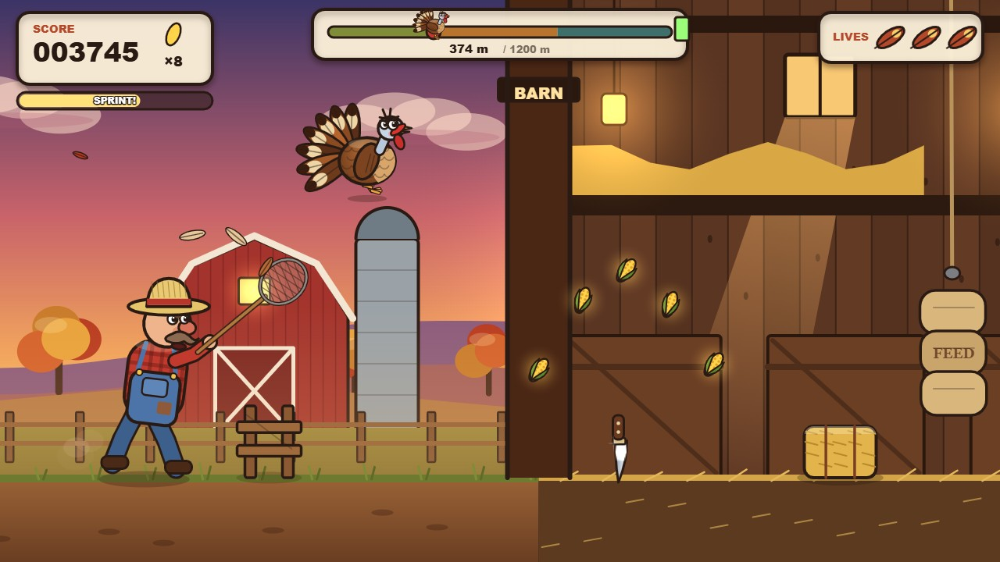
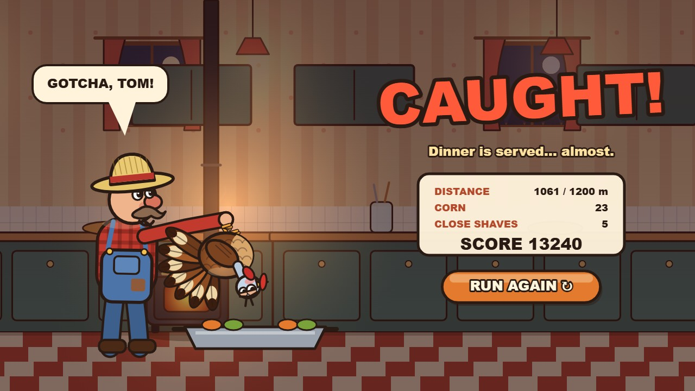

# Wishbone Getaway

[](https://make.fun/bounty/turkey-run-game-01?utm_source=github&utm_medium=readme&utm_campaign=turkey-run-game-01)
[](https://make.fun/bounty/turkey-run-game-01/leaderboard?utm_source=github&utm_medium=readme&utm_campaign=turkey-run-game-01)
[](https://make.fun/bounty/turkey-run-game-01?utm_source=github&utm_medium=readme&utm_campaign=turkey-run-game-01)

**Tom the turkey has heard the word "Thanksgiving" one too many times.** Help him run from Farmer
Hoskins and his net through the sunset farmyard, the old barn and the farmhouse kitchen, past thrown
carving knives and a fire-breathing cast-iron oven, to the back door and freedom.



| | |
| --- | --- |
|  |  |
|  | |

## Play

A side-scrolling escape run, 1,200 m long, in three stages that get harder as you go.

| Key | Mouse | Does |
| --- | --- | --- |
| Space / ↑ / W | left click | jump; press again in the air to flap (double jump); hold for a higher jump |
| ↓ / S | right button | duck under washing lines, feed sacks and pot racks; in the air, drop fast |
| → / D / Shift | both buttons | sprint: pull away from the farmer while your stamina lasts (corn refills it) |
| P / Esc | | pause |
| M | | sound on or off |

- **The farmer** gains on you all the time (faster in later stages) and lunges when he is close. Each hit
  costs a life *and* lets him close in. Three hits, or letting him reach you, and you are **caught**.
- **Carving knives** are thrown ahead of you: a red target ring marks where each will land, then it
  sticks in the floor, glinting, and must be jumped.
- **The oven** glows hotter, rattles and shows *HOT!* before its door drops and a jet of flame rolls out.
  Time your jump over it.
- Near misses slow time for a moment and score a *Close shave*. Corn scores and refills stamina.
- Reach the kitchen's back door to **escape**. Your best score is kept in the browser.

Run it locally (Node 22, nothing to install):

```sh
node serve.ts          # then open http://localhost:8080
```

## How it is made

Everything is drawn in code with Canvas 2D paths (no image or font files) and every sound is synthesised
with WebAudio. The source is split by job:

- `game/src/world.js` – the run: turkey physics, the farmer's chase and knife throws, hits, near misses, endings
- `game/src/spawner.js` – lays the course out per stage, spaced to the turkey's jump reach
- `game/src/hazards.js` – hazard boxes and cycles (oven door, knife flight)
- `game/src/effects.js` – feathers, dust, embers, sparks, leaves, pop-ups, screen shake
- `game/src/audio.js` – synthesised music and sound effects
- `game/src/art/` – `turkey.js`, `farmer.js`, `hazards.js`, `scenery.js`, `logo.js`, `hud.js`, `screens.js`
- `game/src/shots.js` – the staged screenshot scenes (`?shot=title|play|barn|end|escaped`)
- `tools/screenshots.mjs` – renders `screenshots/` in headless Chrome
- `main.ts` – hands the game in for make.fun, writing the dossier with `vendor/makefun-game.ts`

## License

MIT
